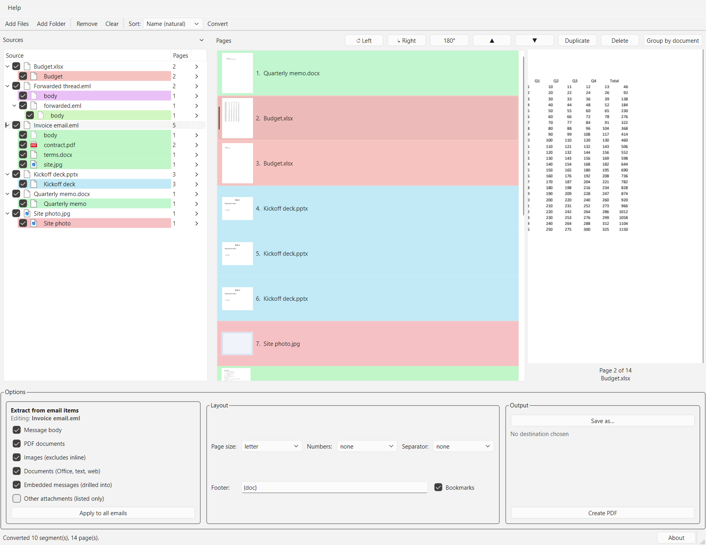
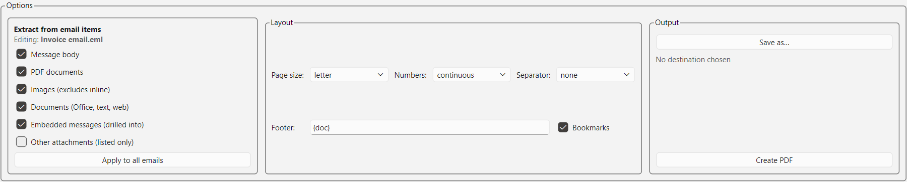

# PDF Consolidator

Converts a set of mixed files into one merged PDF: Word, Excel, PowerPoint,
Outlook items, email, images, plain text and existing PDFs. A desktop window
lets you reorder, rotate and remove pages before saving.



## Runs offline

No internet connection is needed. All conversion happens on your machine, and
files are never uploaded anywhere. The app makes no network requests, and
remote images linked from HTML emails are not downloaded.

It is built on local, open-source components:

| Component | Used for |
|---|---|
| [LibreOffice](https://www.libreoffice.org/) (headless) | Office documents, HTML and email bodies to PDF |
| [extract-msg](https://github.com/TeamMsgExtractor/msg-extractor) | reading Outlook `.msg` files |
| Python `email` package | reading `.eml` files |
| [img2pdf](https://gitlab.mister-muffin.de/josch/img2pdf), [Pillow](https://python-pillow.org/) | images to PDF |
| [pypdf](https://github.com/py-pdf/pypdf), [pikepdf](https://github.com/pikepdf/pikepdf), [reportlab](https://www.reportlab.com/) | merging, page fitting, page numbers and headers |
| [pdfium](https://pdfium.googlesource.com/pdfium/) | page previews, thumbnails and the output check |
| [Qt](https://www.qt.io/) (PySide6) | the desktop window |

The development script `tools/vendor.py` downloads packages from PyPI. It is
not part of the app.

## How to use

### Start the app

- **Standalone build:** copy the `PDFConsolidator` folder to the machine and run
  `PDFConsolidator.exe`. Nothing else needs to be installed. See
  [Building the standalone bundle](#building-the-standalone-bundle).
- **From source:** run `.venv\Scripts\python -m consolidator gui`, optionally
  followed by files or folders to load. See
  [Install (development)](#install-development).

### Make a PDF

1. Click **Add Files…** or **Add Folder…**. Conversion starts automatically,
   and the progress bar in the status bar shows how far it has got.
2. Check the **Sources** list. Untick anything you don't want, such as an
   email's body or one of its attachments.
3. Arrange the **Pages** list: drag pages to reorder them, and use the buttons
   to rotate, duplicate or delete them. Click a page to preview it.
   **Scan for duplicates** finds pages that appear more than once, for example
   an attachment that is also in another email, so you can remove the repeats.
4. Choose the **Layout** options: page size, page numbers, separators, footer
   and bookmarks.
5. Click **Save as…** to pick the output file, then **Create PDF**. (If you
   skip **Save as…**, **Create PDF** asks for a location.)

When it is done, the status bar shows the file name and how many pages were
written. If any page failed the [output check](#output-check), a banner above
the page list names it.

### Two phases: convert, then create

1. **Convert.** Each file is turned into PDF pages as soon as it is added. This
   is the slow part, because Office documents and email bodies go through
   LibreOffice. Only newly added files are converted, so your page edits are
   kept. **Reconvert All** in the toolbar redoes every file from scratch.
2. **Create.** **Create PDF** merges the pages in the order shown, fits them to
   the page size, and adds page numbers, footer and bookmarks. This does not
   use LibreOffice and takes seconds, so you can change the layout and create
   the PDF again as often as you like.


## Window reference

### Menus

- **File:** Add Files… (**Ctrl+O**), Add Folder…, Create PDF… (**Ctrl+S**),
  Reconvert All, Clear and Exit.
- **Help:** About and Licences.

### Toolbar

| Control | What it does |
|---|---|
| **Add Files…** | Add one or more files. The file dialog lists every supported type. |
| **Add Folder…** | Add every supported file in a folder, including subfolders. |
| **Remove** | Remove the selected source and its pages. |
| **Clear** | Remove all sources and pages. |
| **Sort** | Order the source list by name (natural order, so `file2` comes before `file10`), date modified, size or type. |
| **Reconvert All** | Re-convert every source from scratch, discarding page edits (order, rotation, deletions). Normally not needed: new files are converted automatically, and only new files are converted, so your page edits are kept. |

### Sources (left)

One row per input file. Expand a row to see what it produced: the document, or
an email's body and each of its attachments. An email attached to another email
appears as a child row with its own body and attachments. Parts are listed in
the order the email stores them.

- **Tick box:** untick a row to leave its pages out of the PDF. Unticking an
  email leaves out everything inside it. Ticking it again puts the pages back
  where they were.
- **Pages column:** how many pages the row produced.
- **Arrow (›) at the end of a row:** selects that row's first page in the page
  list and scrolls to it. It follows the page's current position, so it still
  works after pages are reordered. The arrow beside the *Sources* heading and
  **Ctrl+J** do the same for the selected row. Clicking the row itself does not
  move the page list.
- **Delete** or **Backspace:** removes the selected source and its pages.
- A warning icon means an attachment could not be read. Hover over it for the
  reason.

### Pages (middle)

One row per page of the output, in output order. Each row shows the page
number, the file it came from, the emails it was found inside, and its rotation
if it has one. Rows are coloured by source, so each file reads as a block. An
attached email gets a different colour from the email that carried it.

| Control | What it does |
|---|---|
| Drag and drop | Reorder pages. Select several rows (Ctrl/Shift+click) to move them together. |
| **↺** / **↻** / **180°** | Rotate the selected pages left, right or half a turn. |
| **Up** / **Down** arrows | Move the selected pages up or down by one. |
| **Duplicate** | Insert a copy of the selected pages after them. |
| **Delete** (button, key, or Backspace) | Remove the selected pages. |
| **Group by document** | Put each file's pages together, keeping each file's own page order. |
| **Scan for duplicates** | Find pages that repeat an earlier page and list them with a confidence score: 100% the same page twice, 99% identical text, 96% the same text apart from whitespace or letter case, up to 94% for mostly matching text, and up to 90% for pages without text that look alike. Blank pages are ignored. Each duplicate's row in the page list is tagged "[duplicate *n*%]" (hover for the page it repeats); double-click the row, or click the link under the preview, to jump to that page, wherever it has since been moved. Click a row to show the page; matches of 95% or more are checked, checked pages are struck through in red in the page list, and **Delete checked pages** removes them, keeping the earlier copy. |

### Preview (right)

Shows the selected page as it will be written, including rotation, scaled to
fit the pane. **−**, **Fit** and **+** above it zoom in up to 3×; scroll to see
the rest of a zoomed page. Underneath are "Page *n* of *total*" and the source
file. For a page found by
**Scan for duplicates**, a link underneath names the page it repeats and jumps
to it.

### Options



**Extract from email items** decides which parts of an email (`.eml`, `.msg`)
become pages.

The checkboxes edit the email selected in the Sources list; the label above
them names it ("Editing: …"). With no email selected, they set the default for
emails added later. **Apply to all emails** gives every email the current
settings.

| Checkbox | Effect |
|---|---|
| Message body | The headers and body become a page. |
| PDF documents | Attached PDFs are added unchanged. |
| Images (excludes inline) | Attached images become pages. Images shown inside the body, such as signature logos, are skipped. |
| Documents (Office, text, web) | Attached Word, Excel, PowerPoint, HTML, text, Markdown and CSV files are converted. |
| Embedded messages (drilled into) | Attached emails are opened, and their body and attachments become pages, up to 4 levels deep. |
| Other attachments (listed only) | Attachments of other types are listed by name on the body page. Off by default. |

**Layout** applies when the PDF is created. Changing it does not re-convert
anything.

| Option | Choices |
|---|---|
| Page size | `letter` (default), `a4`, `legal`: each page is scaled to fit with a 0.5 inch margin. `original`: pages keep their own size. |
| Numbers | `none`, `continuous` (one sequence for the whole PDF), or `per-document` (restarts for each file). Printed as "*n* of *total*" at the bottom right when there is a footer, or at the bottom centre when the footer is empty. |
| Separator | `none`, `blank` (an empty page between files), or `title` (a page with the file name between files). |
| Footer | Text printed at the bottom of every page. Placeholders: `{doc}` file name, `{n}` page number, `{total}` page count, `{n_doc}` / `{total_doc}` page number and count within the file, `{date}` today's date. Example: `{doc} – page {n} of {total}`. Empty by default (no footer); hover the info icon beside the field for this list. Long text wraps onto up to three lines; long file names break at `_`, `-` or `.`. |
| Bookmarks | Adds a PDF bookmark for each file, so viewers show a clickable outline. |

**Output**

| Control | What it does |
|---|---|
| **Save as…** | Choose the output file. The chosen path is shown underneath. |
| **Create PDF** | Write the PDF. An existing file is never overwritten: if `report.pdf` exists, the output is written as `report (1).pdf`, then `report (2).pdf`, and so on. The status bar shows the name used. |

### Status bar and banner

- **Progress bar and Cancel:** shown while converting. **Cancel** stops after
  the current file and keeps everything already converted.
- **Banner:** appears above the lists if files fail to convert or pages fail
  the output check. **Details…** lists them, **Retry failed** converts the
  failed files again, and **Dismiss** hides the banner.
- **About** is under *Help*: version, copyright, licence and warranty
  disclaimer, with a link to every third-party licence.

### Closing

Closing the window asks for confirmation (the default answer is No) and says
what would be lost: a running conversion, an unfinished PDF, or your page
arrangement.

## Requirements

- Windows
- LibreOffice, for Office documents and email bodies (the standalone build
  includes it)
- Python 3.10+ (development only)

## Install (development)

```sh
python -m venv .venv
.venv\Scripts\python -m pip install -e ".[dev]"
```

Generate sample input and open the window:

```sh
.venv\Scripts\python tools\make_fixtures.py
.venv\Scripts\python tools\make_email_fixtures.py
.venv\Scripts\python -m consolidator gui
```

## How it works

### Large batches

- **Parallel conversion.** LibreOffice conversion takes almost all of the time,
  so up to four `soffice` processes run at once (or half the logical cores, if
  lower). Each has its own profile and output folder. Measured: 48 documents
  took 63 s one at a time and 23 s four at a time. Set `CONSOLIDATOR_WORKERS=1`
  to turn this off.
- **Retry.** If a chunk produces no output at all, it is retried once after a
  short pause. This usually means LibreOffice failed to start, not that the
  documents are bad.
- **Progress.** Large batches are split into about 15 chunks so the progress bar
  updates during conversion. Each chunk adds about 5 s of LibreOffice start-up.
  Small batches are not split. **Cancel** stops after the current file and keeps
  what is already converted.
- **Thumbnails** are rendered only for visible rows plus a margin.
- **Caches** for thumbnails and open documents have a fixed size, so memory and
  file handles do not grow with the batch.

Measured on Windows with LibreOffice 26:

| Scenario | Result |
|---|---|
| 600 PDFs converted | 0.8 s, 0 failures |
| …loaded into the window | 0.6 s (600 source rows, 1200 page rows) |
| …source list rebuild / page list rebuild | 0.06 s / 0.11 s |
| …thumbnails rendered | 40 of 1200 |
| 240 Office documents converted | 156 s, 0 failures; **65 s with 4 workers** |
| …longest gap between progress updates | 16 s |
| …loaded into the window | 0.17 s |
| 3,000 PDFs converted / loaded / assembled | 3.9 s / 3.0 s / 8.9 s (6,000 pages) |
| 10,000 PDFs converted / loaded / assembled | 13.8 s / 10.7 s / 32.4 s (20,000 pages) |
| …source list rebuild / page list rebuild at 10,000 rows | 2.0 s / 1.1 s |
| …thumbnails rendered at 20,000 rows | 40 |

About 1,000 Office documents take roughly 11 minutes to convert. Everything
after conversion is close to instant.

**Known limit.** At 10,000 files a full rebuild of the source list takes 2–3 s
and gets slightly slower with each rebuild. This is Qt item overhead on Windows,
not a Python memory leak. Editing, thumbnails and preview are not affected. The
fix would be to update only changed rows instead of rebuilding the tree. It is
not done yet because at normal sizes a rebuild takes 0.06 s.

### Attached emails

An attached email (for example a forward) is opened, and its body and
attachments become pages. If email A carries email B, and B has an attachment,
that attachment is listed under B, not A.

Two implementation details make this work:

- `_walk_parts` stops `Message.walk()` from descending into attached messages.
  Otherwise B's attachments would be listed again as A's.
- `_decode_part` re-serialises attached messages, because
  `get_payload(decode=True)` returns `None` for `message/rfc822`, which would
  produce an empty file.

Tests cover a three-level chain (A → B → C → PDF).

### Outlook items

Outlook can attach items that are not emails: meetings, contacts, tasks, or
documents stored in a mail folder. Each is read by type. Its body becomes a page
headed with the item type (for example "Appointment" or "Contact") and its main
fields. Its attachments are extracted like an email's.

- The `.msg` file is opened in lenient mode. In strict mode, `extract-msg`
  fails on the whole message if one attached item has an unsupported class
  (`IPM.Document.*`, `IPM.Outlook.Recall`) or has no data stream.
- Attached items are parsed directly from the parent message, not exported and
  re-parsed.
- No attachment is skipped silently. Empty, damaged or cloud (link-only)
  attachments each get a row with the reason, and are listed on the body page.

### Output check

Assembly resizes, rotates and adds page numbers, and any of these can drop
content without raising an error. After the PDF is written, each output page is
compared with its source page using pdfium:

- every word on the source page must appear on the output page (extra words,
  such as page numbers, are allowed)
- the output page must have at least as many images
- no source text may fall outside the output page

Failures are shown in the status bar, the banner, the *Done* dialog, and on the
command line, for example:
`MISSING page 4 (mail - invoice.pdf, page 2): 12 of 300 word(s) missing...`.
The check takes about 2 ms per page. It cannot check text drawn as vector
outlines.

## Command line

```sh
consolidator build <paths...> -o out.pdf [options]
consolidator check
consolidator gui [paths...]
consolidator selftest
```

`check` reports the detected LibreOffice. `selftest` converts generated samples
end to end and reports the result.

| Option | Meaning |
|---|---|
| `--page-size` | `letter` (default), `a4`, `legal`, `original` |
| `--margin` | margin in inches when fitting to a page size (default `0.5`) |
| `--separator` | `none`, `blank`, or `title` page between documents |
| `--page-numbers` | `none`, `continuous`, or `per-document` |
| `--number-format` | template using `{n}` `{total}` `{doc}` `{n_doc}` `{total_doc}` `{date}` |
| `--number-position` | e.g. `bottom-center`, `top-right` |
| `--number-start` | first page number (default `1`) |
| `--header-*`, `--footer-*` | text for the `left`/`center`/`right` slot |
| `--title`, `--author`, `--subject` | PDF metadata |
| `--extract` | email attachment categories, comma separated: `body`, `pdf`, `images`, `documents`, `embedded`, `other` (`office` is an old name for `documents`) |
| `--no-body` | omit the message body page |
| `--max-attachment-mb` | skip attachments larger than this (default `64`) |
| `--max-depth` | maximum nested-message depth |
| `--no-bookmarks` | do not add a bookmark per document |
| `--no-recursive` | do not search subfolders |
| `--keep-scratch` | keep intermediate PDFs |

## Building the standalone bundle

```sh
.venv\Scripts\python tools\build.py
```

This produces `dist/PDFConsolidator/`, containing the application and a trimmed
LibreOffice. Copy the folder to the target machine and run
`PDFConsolidator.exe`. Python and Office are not needed. `--zip` also writes
`PDFConsolidator.zip`.

## Supported formats

| Input | Converted by |
|---|---|
| `.docx` `.doc` `.docm` `.dotx` `.dotm` `.xlsx` `.xls` `.xlsm` `.xltx` `.xltm` `.pptx` `.ppt` `.pptm` `.pps` `.ppsx` `.rtf` `.odt` `.ods` `.odp` `.odg` | LibreOffice |
| `.html` `.htm` `.xhtml` | LibreOffice (rendered, not shown as source) |
| `.msg` | `extract-msg` (Outlook is not used) |
| `.eml` | Python standard library |
| `.jpg` `.jpeg` `.png` `.tif` `.tiff` `.bmp` `.gif` `.webp` | `img2pdf` (JPEGs embedded without re-encoding) |
| `.txt` `.md` `.markdown` `.log` `.csv` | plain monospaced text (Markdown is not rendered) |
| `.pdf` | copied unchanged |

Not supported: `.pub`, `.xlsb`, HEIC, OCR.

Supported extensions are defined once in `convert.py` (`OFFICE_EXTS`,
`WEB_EXTS`, `TEXT_EXTS`, `IMAGE_EXTS`, `PDF_EXTS`, `EMAIL_EXTS`, and
`DOCUMENT_EXTS` for the first three combined). The file dialog filter, the
`--extract` categories and the support checks all read these sets, so a new
format only needs to be added there.

## Tests

```sh
.venv\Scripts\python -m pytest tests -q
```

Tests that need LibreOffice or fixtures are skipped when those are missing.
Generate fixtures with `tools/make_fixtures.py` and
`tools/make_email_fixtures.py`. The `.msg` samples in `tests/data/msg/` are
committed; they were built from scratch by `tools/make_msg_samples.py` and
contain no real mail.

Tests only write inside the project folder: temporary files go to `pytest-tmp/`,
not the system temp directory.

## About

PDF Consolidator 0.3.0. Copyright (C) 2026 Xiaoyu-Ben-Wang.

The **About** dialog in the app shows the version, copyright, licence and
warranty disclaimer, and links to every third-party licence.

## Licence and warranty

### No warranty

**The software is provided "as is," without any express or implied warranty.
The authors are not liable for any damages.** This includes any warranty of
merchantability or fitness for a particular purpose. Use it at your own risk,
including the risk of losing documents or data.

### Licence

PDF Consolidator is licensed under the **GNU General Public License, version 3
or later** (GPL-3.0-or-later). The full text is in [`LICENSE`](LICENSE).
Sections 15 and 16 of the GPL contain the formal warranty disclaimer and
limitation of liability.

The GPL is required because `extract-msg` (the `.msg` reader) is GPL-3.0. All
other dependencies are GPL-compatible:

| Component | Licence |
|---|---|
| extract-msg | GPL-3.0 |
| Qt (PySide6), img2pdf, RTFDE | LGPL-3.0 |
| pikepdf | MPL-2.0 |
| LibreOffice (bundled) | MPL-2.0 |
| pypdf, reportlab, Pillow, pywin32 and others | permissive (BSD, MIT, PSF and similar) |

[`THIRD-PARTY-NOTICES.md`](THIRD-PARTY-NOTICES.md) lists every component, and
[`LICENSES/`](LICENSES) contains each licence text unchanged.

### Files shipped with the bundle

Next to the executable: `LICENSE`, `THIRD-PARTY-NOTICES.md`, `LICENSES/`, and
LibreOffice's own notices under `libreoffice/`.

`tools/collect_licenses.py` builds the notices from the installed packages, so
new dependencies are picked up automatically. The build copies the notices and
checks that every bundled module is covered:

```sh
.venv\Scripts\python tools\collect_licenses.py
.venv\Scripts\python tools\build.py
```

Qt is used under LGPL-3.0. Its wheels only include a commercial licence
reference, so the LGPL text is added as `LICENSES/LGPL-3.0.txt`. The Qt DLLs in
`_internal/PySide6/` can be replaced with another build of the same version, as
the LGPL requires.

### Source code

GPL-3.0 section 6 requires the source to be available to anyone who receives
the binaries. This repository is the full source, including build scripts.

Before publishing the bundle, set `SOURCE_URL` at the top of
`tools/collect_licenses.py` to the repository URL and re-run it, so the notices
include the link. LibreOffice is redistributed unmodified apart from trimming;
its source is published by The Document Foundation.
